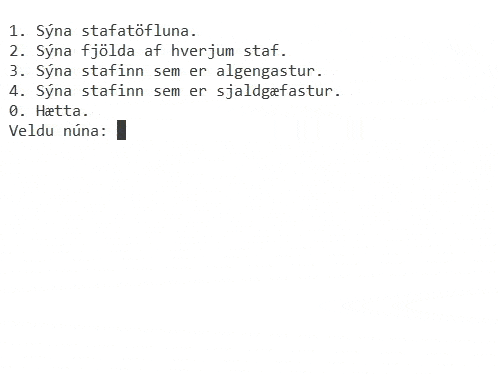

# FORR3CG - Skilaverkefni 1 (2,5%)

- **Skilafrestur** er til miðnættis þriðjudaginn 27. október.
- **Sein skil**, ekki er hægt að bjóða upp á sein skil fyrir verkefnið, lausn verður birt í tímanum miðvikudaginn 28. október.
- **Ekki er heimilt** að nota tilbúnar lausnir fyrir fylkin (t.d. std::vector) og ekki nota `global` breytur.
- **Það á að nota** `do-while` og `switch-case` við lausn valmyndarinnar.

## Verkefnalýsing - Stafarugl

Skrifaðu forrit sem tekur eitthundrað bókstafi (bara enska stafrófið) af handahófi (e. random) og setur í tvívítt fylki (10 x 10). Forritið þarf svo að eiga annað fylki (einvítt) sem heldur utan um hversu oft hver stafur kemur upp.

Forritið á svo að birta valmynd þar sem notandinn getur valið um að gera eftirfarandi:

- Sjá allar 100 bókstafina, skrifist snyrtilega út í 10 línum, 10 bókstafir í línu.
- Sjá fjölda af hverjum bókstaf.
- Sjá bókstafinn sem kom oftast upp og hversu oft hann kom upp. __*__
- Sjá bókstafinn sem kom sjaldnast upp og hversu oft hann kom upp. __*__
- Hætta keyrslu forritsins.

__*__ ekki þarf að bregðast sérstaklega við ef tveir eða fleiri bókstafir koma jafn oft eða sjaldan upp. Nóg er að birta einn.

Forritið þarf svo að bregðast við með viðeigandi hætti ef notandi velur eitthvað annað en það sem er í boði í valmyndinni.

Vísbendingar:
- Muna eftir [ASCII töflunni](https://thumb.wikimedia.org/wikipedia/commons/thumb/d/dd/ASCII-Table.svg/1280px-ASCII-Table.svg.png?utm_source=commons.wikimedia.org&utm_campaign=index&utm_content=thumbnail) og að A + 1 = B.
- Best að setja í bæði fylkin (stafafylkið og talningarfylkið) í sömu lykkjunni.

### Dæmi um virkni



## Skil á verkefninu

Skilið verkefninu á Canvas. Skilin ættu að vera ein .cpp skrá.

## Bjargir

### Slembitölur (e. random)

Til að nota slembitölur í C++ þarf að nota söfnin `cstdlib` og `ctime`. Fallið `srand` er svo notað til að "seed-a" slembifallið og fallið `rand` notað til að fá slembitölu. Dæmi:

```c++
#include <iostream>
#include <cstdlib>
#include <ctime>

int main() {
    std::srand(std::time(0));
    for(int i = 0; i < 5; i++) {
        std::cout << std::rand() % 10 << std::endl; // skrifar út eina tölu á bilinu 0 til og með 9
    }
    return 0;
}
```
